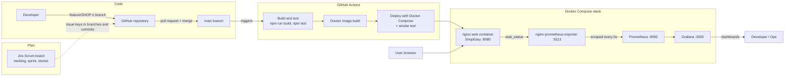

# End-to-End DevOps Architecture (ShopEasy)

| Stage | Tool | Evidence to screenshot |
|---|---|---|
| Plan | Jira (Scrum) | Sprint board, backlog |
| Version control | Git + GitHub | Branches, pull requests, merge history |
| CI/CD | GitHub Actions | Green run with the 3 jobs |
| Containerise and deploy | Docker + Docker Compose | `docker compose ps`, app on :8080 |
| Monitor | Prometheus + Grafana | Targets page (UP), ShopEasy dashboard |
